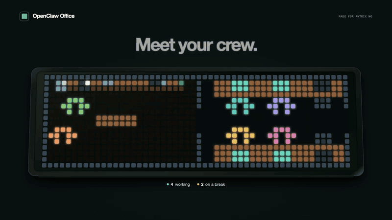
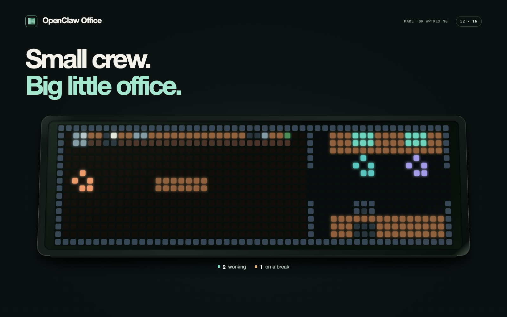
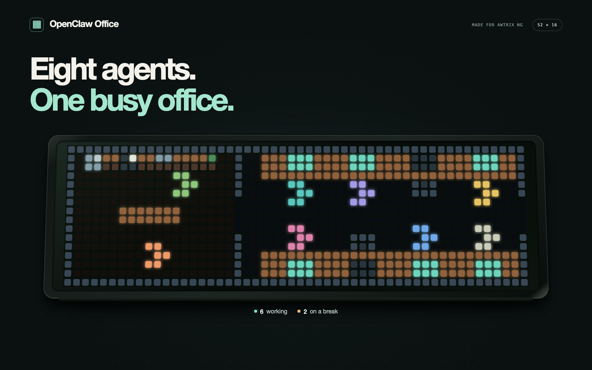
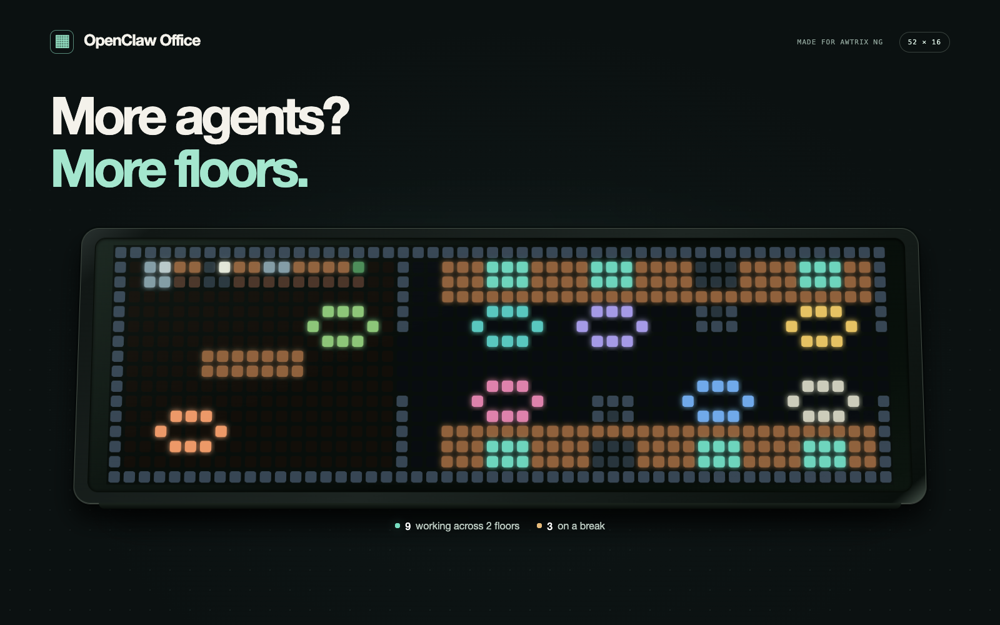
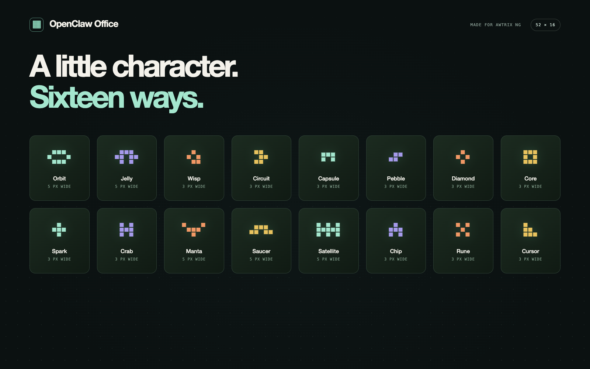

# OpenClaw Office for AWTRIX

**A tiny office for your OpenClaw agents.**

See who’s working and who’s taking a break, right on your pixel clock.

[](https://github.com/eliseo-juan/openclaw-office-awtrix/actions/workflows/ci.yml)
[](LICENSE)




[Watch the 24-second film](media/assets/showcase.mp4) · [Installation guide](docs/INSTALL.md) · [Download the AWTRIX script](OpenClawOfficeLive.ax)

*The preview uses fictional agents and simulated activity. Movement is accelerated for presentation.*

## A little office, your whole crew

Working agents head to their desks. Idle agents wander around the cafe. When work starts, they return to their seats.

- **Room to grow.** Up to eight desks per floor; larger teams use additional floors.
- **Pick your characters.** Sixteen office-wide bot styles, including Jelly, Orbit, Wisp and Circuit.
- **Choose the caffeine.** Decaf, Coffee or Espresso sets the cafe’s pace.
- **Keep it in view.** Always on holds Office on screen; turn it off for normal rotation.
- **Know when it’s offline.** Orange walls and an OFFLINE message mark unavailable activity.

<table>
<tr>
<td><br><strong>Start small.</strong> Three agents, room to breathe.</td>
<td><br><strong>A full house.</strong> Eight agents, one busy office.</td>
</tr>
<tr>
<td><br><strong>Keep growing.</strong> More agents, more floors.</td>
<td><br><strong>Make it yours.</strong> Sixteen ways to bring the crew to life.</td>
</tr>
</table>

## Get started

You need an **Ulanzi TC002 running AWTRIX NG (52 × 16)** and **OpenClaw 2026.9.2 or newer**. The clock must be able to reach the bridge over your network.

On the OpenClaw Gateway machine, as the same OS user that runs OpenClaw:

```sh
openclaw plugins install git:github.com/eliseo-juan/openclaw-office-awtrix
openclaw plugins enable openclaw-office
openclaw office setup
```

Follow the prompts. Setup pairs a read-only device, checks the connection and prints your Bridge URL. It may restart the Gateway.

Then, in AWTRIX:

1. Import [OpenClawOfficeLive.ax](OpenClawOfficeLive.ax) using the script editor.
2. Open **OpenClaw Office → Settings**.
3. Set **Bridge URL** to the URL printed by setup, save and start the app.

Choose your bot style, caffeine level and display preferences in the app settings.

[Full setup and troubleshooting](docs/INSTALL.md) · [Let an agent handle installation](skills/install-openclaw-office/SKILL.md)

## How it works

```text
OpenClaw Gateway → Office bridge → AWTRIX pixel office
```

The native plugin manages a companion bridge with a scoped `operator.read` device credential. The clock polls small display pages. Gateway credentials stay on the host; the clock does not read conversation transcripts. Setup disables prompt injection and conversation access hooks. OpenClaw 2026.9.2’s initial capability prompt uses host defaults, which the package cannot change.

Before configuration, SETUP appears with example bots. With live data, the office reflects the activity available from your Gateway. Cafe motion is decorative and does not imply conversations between agents. Disconnected or stale activity is treated as unknown.

The bridge’s HTTP endpoint exposes agent names and activity without authentication. Keep it on a trusted network; see [security and private reporting](SECURITY.md).

## Development and checks

```sh
npm ci --ignore-scripts --legacy-peer-deps
npm test
npm run check
npm run plugin:check
```

CI runs the tests on Node 22, 24 and 26, verifies the actual npm package, checks syntax and metadata, runs the official OpenClaw plugin inspector, audits dependencies and scans Git history for secrets. Inspector reports are retained as CI artifacts. These checks do not replace live Gateway or physical clock testing.

[Contributing](CONTRIBUTING.md) · [CI design and plugin-repository references](docs/CI.md) · [Media kit and capture instructions](media/README.md)

[MIT licensed](LICENSE). This project contains the Office application and bridge; AWTRIX firmware is a separate project.
